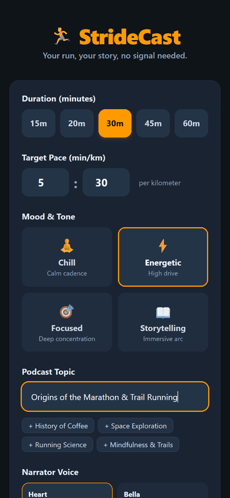
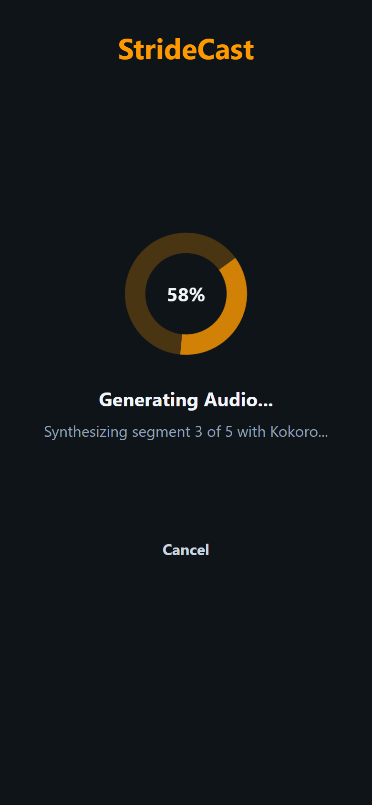
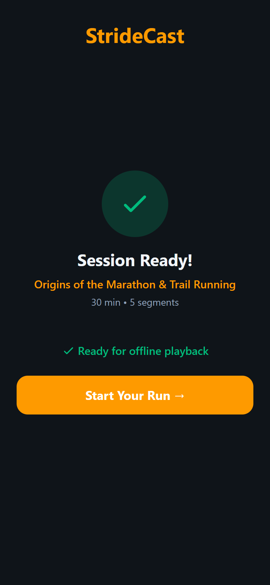
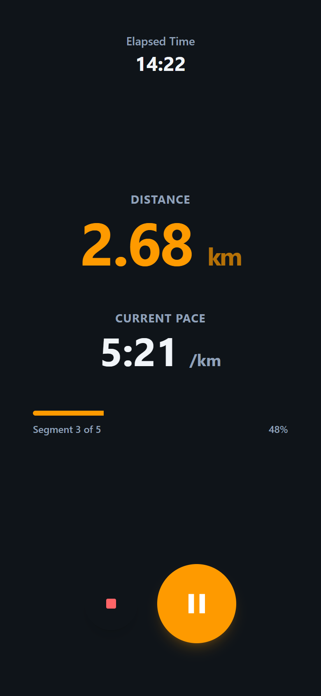
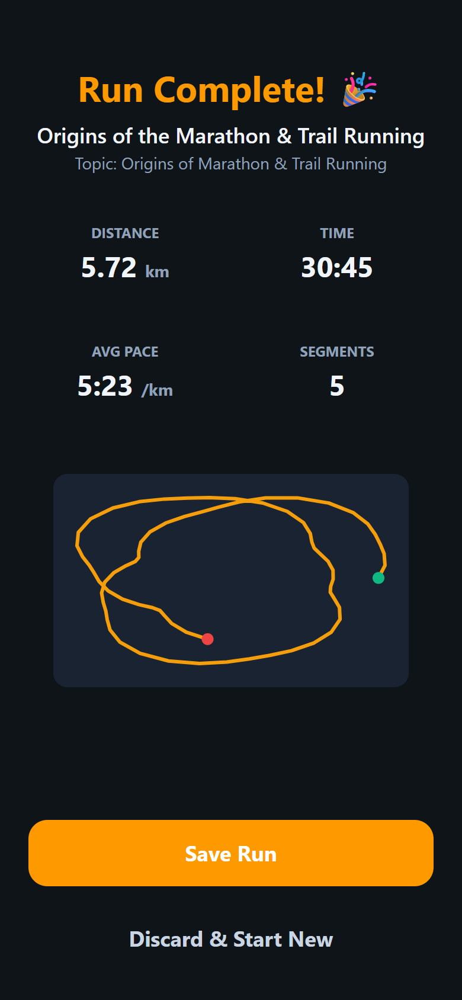
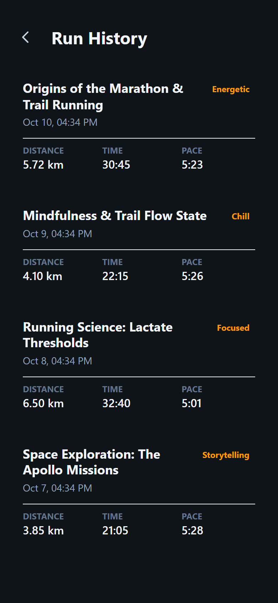

# 🏃 StrideCast

**Your run, your story, no signal needed.**

<p align="center">
  
</p>

StrideCast is a mobile-first PWA running companion that generates a personalized podcast for your run using open-source AI — then plays it offline while tracking your pace and route.

Built for the [DEV Hacktoberfest Open-Source AI Challenge: Week 1](https://dev.to/) (theme: "Touch Grass").

---

## 📱 Screenshots

<table>
  <tr>
    <td align="center" width="16.6%">
      <br />
      <sub><b>1. Pre-Run Setup</b><br />Duration, pace, mood & topic</sub>
    </td>
    <td align="center" width="16.6%">
      <br />
      <sub><b>2. Live Generation</b><br />SSE progress stream</sub>
    </td>
    <td align="center" width="16.6%">
      <br />
      <sub><b>3. Offline Ready</b><br />Cached to phone storage</sub>
    </td>
    <td align="center" width="16.6%">
      <br />
      <sub><b>4. Run Screen</b><br />Distance, pace & voice coach</sub>
    </td>
    <td align="center" width="16.6%">
      <br />
      <sub><b>5. Run Summary</b><br />Stats & offline SVG route</sub>
    </td>
    <td align="center" width="16.6%">
      <br />
      <sub><b>6. Past Runs</b><br />Saved on-device (IndexedDB)</sub>
    </td>
  </tr>
</table>

---

## ✨ How It Works

1. **Set up** (~30 seconds): Pick your duration, pace, mood, voice, and podcast topic
2. **Generate**: Local AI writes a podcast script and narrates it segment by segment
3. **Cache**: Audio files download into the browser Cache API for 100% offline playback
4. **Run**: Turn on Airplane mode and head outside! Audio plays while GPS tracks your route and pace
5. **Review**: See your run summary with pace stats, milestones, and offline SVG route map

---

## 🛠 Tech Stack

| Layer | Tech | Description |
|-------|------|-------------|
| **Frontend** | React 19 + TypeScript + Tailwind CSS v4 | Mobile-first PWA, dark high-contrast theme |
| **PWA** | vite-plugin-pwa (Workbox) | Offline runtime caching for `/api/audio/*` |
| **State & Storage** | Zustand + IndexedDB (`idb`) | Zero accounts, zero cloud database, all data on-device |
| **Backend** | Python FastAPI + Uvicorn | Async REST API & Server-Sent Events |
| **LLM** | Ollama (Gemma 2B / Gemma 3) | Segmented podcast generation (~150 words/min) |
| **TTS** | Kokoro / pyttsx3 | Modular local speech synthesis outputting WAV audio |
| **Pace Coach** | Custom offline pacing engine | Pre-synthesized nudges played at segment boundaries |
| **GPS & Sensors** | Geolocation API + Screen Wake Lock | Noise-filtered GPS + Haversine distance tracking |

**All AI runs locally. No cloud APIs. No accounts. Your location and run history never leave your device.**

---

## 🚀 Quick Start

### Prerequisites

- **Node.js** 18+
- **Python** 3.10+
- **Ollama** running locally ([install](https://ollama.ai))

### 1. Clone and Install

```bash
git clone <repo-url> stridecast
cd stridecast
```

Install backend:
```bash
cd backend
pip install -r requirements.txt
```

Install frontend:
```bash
cd frontend
npm install
```

### 2. Set Up Ollama

```bash
ollama pull gemma3:latest
# or: ollama pull gemma2:2b
```

### 3. Check Setup

Run the automated diagnostic check:
```bash
npm run check
# or: cd backend && python scripts/check_setup.py
```

### 4. Run Development Servers

Start both backend and frontend with a single command:
```bash
npm run dev
```
*(On Windows, you can also run `.\dev.ps1` in PowerShell, or `make dev`).*

Open **http://localhost:5173** in your browser.

---

## 📱 Testing on Your Phone (Offline Touch-Grass Mode)

### The HTTPS Requirement
Mobile browsers require **HTTPS** to activate the **Geolocation API** and **Service Workers** (except on `localhost`).

#### Option A: Quick HTTPS Tunnel (Easiest)
```bash
ngrok http 5173
# or: npx localtunnel --port 5173
```
Open the generated HTTPS URL on your phone's browser, and tap **"Add to Home Screen"**.

#### Option B: Local Wi-Fi with `mkcert`
```bash
# 1. Install mkcert & create certificate for your laptop IP
mkcert -install
mkcert localhost 192.168.x.x

# 2. Reference in frontend/vite.config.ts:
# server: { https: { key: './192.168.x.x-key.pem', cert: './192.168.x.x.pem' } }
```

### Going for an Offline Run:
1. Open StrideCast on your phone.
2. Select your run duration, target pace, mood, and topic.
3. Tap **"Generate My Run"** (or toggle **Demo Mode** for instant sample generation).
4. Watch progress stream live until the **"Ready for offline playback ✓"** badge appears.
5. **Turn on Airplane Mode**.
6. Tap the giant amber **START** button: audio plays smoothly from device cache, Wake Lock keeps your screen active, and GPS tracks your route offline!
7. Tap **Stop** to view your route and save the run locally to IndexedDB.

---

## 🎮 Demo Mode

StrideCast includes a **Demo Mode** toggle directly on the Setup screen. When enabled, it instantly delivers pre-generated, realistic audio sessions with pace coaching nudges so you can test and record demo videos without waiting for local LLM/TTS generation.

---

## 🧪 Running Tests

Run the test suite from root:
```bash
npm test
# or: cd backend && pytest tests
```

Tests cover:
- Word count and segment math (~150 words/min)
- Great-circle Haversine distance calculations
- GPS noise smoothing (<30m accuracy threshold) and impossible speed filtering (<12 m/s)
- Pydantic manifest schema validation
- FastAPI `/api/health` and SSE `/api/generate` endpoints

---

## 📁 Project Structure

```
├── docs/
│   ├── demo.gif           # Animated walkthrough GIF
│   └── screenshots/       # Mobile 390x844 screenshot captures
│       ├── 01-setup.png
│       ├── 02-generating.png
│       ├── 03-offline-ready.png
│       ├── 04-run.png
│       ├── 05-summary.png
│       └── 06-history.png
├── frontend/              # Mobile-First React 19 + TypeScript PWA
│   ├── src/
│   │   ├── pages/         # Setup, Generating, Run, Summary, History
│   │   ├── components/    # RouteCanvas (offline SVG route)
│   │   ├── hooks/         # useAudioPlayer, useGeolocation, useWakeLock
│   │   ├── stores/        # Zustand state stores
│   │   └── utils/         # audio cache, gps, haversine, idb
│   └── vite.config.ts     # PWA Service Worker + Workbox audio cache
├── backend/               # Python FastAPI API & Local AI
│   ├── app/
│   │   ├── routers/       # health, generate (SSE), audio
│   │   ├── services/      # script_generator, tts, session_manager
│   │   ├── models.py      # Pydantic v2 schemas
│   │   └── utils.py       # Haversine & GPS smoothing
│   ├── scripts/           # check_setup.py diagnostics
│   └── tests/             # Pytest test suite
├── Makefile               # Make launcher
├── dev.ps1                # PowerShell launcher
├── package.json           # Root scripts (npm run dev, test, check)
├── BUILD_LOG.md           # Architecture & engineering decisions log
└── README.md
```

---

## 📝 License

MIT

## 🙏 Acknowledgments

- [Ollama](https://ollama.ai) — Local LLM inference
- [Kokoro](https://github.com/hexgrad/kokoro) — Open-source TTS
- Built for the [DEV Hacktoberfest Open-Source AI Challenge: Week 1](https://dev.to/)
